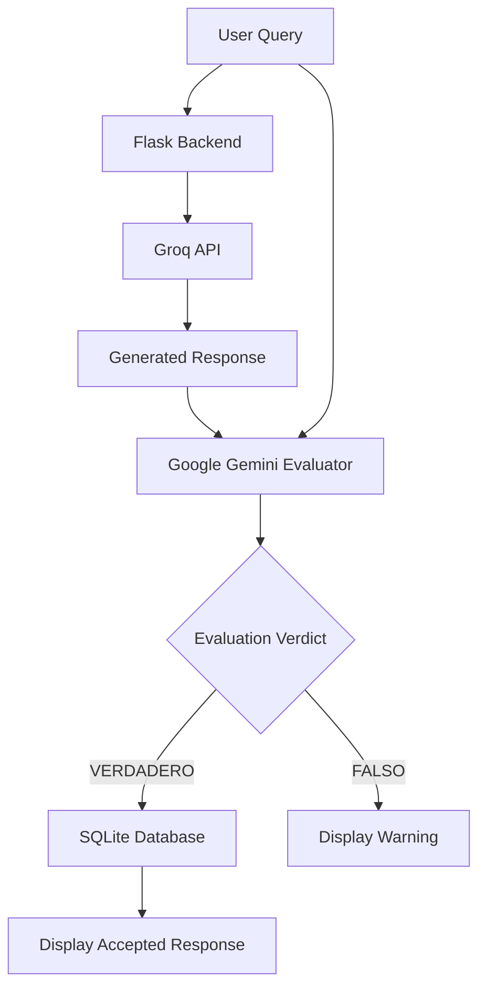

# VERITAS CHAT: AI-Assisted Hallucination Detection System
#### Video Demo:  https://www.youtube.com/watch?v=pxlnYz4MQBQ
#### Description:

**Veritas Chat** is a full-stack web application developed as a final project for Harvard's CS50x course. Its primary goal is to explore one of the most common limitations of modern Generative Artificial Intelligence: **hallucinations** — instances where a Large Language Model (LLM) generates information that appears plausible but is factually incorrect or fabricated.

Instead of relying on a single AI model to respond to user queries, Veritas Chat implements a **cross-model evaluation architecture** that utilizes two independent AI models working together.

When a user submits a query through the web interface, a primary generative model produces an initial response. Before this response is accepted or saved to the user's conversation history, a second AI model acts as an evaluator. It analyzes the original query alongside the generated response and returns a binary verdict: `VERDADERO` or `FALSO`.

Responses classified as `VERDADERO` are accepted and stored in the SQLite database, while responses classified as `FALSO` are rejected and accompanied by a warning.

It is important to clarify that this mechanism represents an AI-assisted evaluation process, not an absolute guarantee of factual accuracy. The evaluator is also an AI model and may produce incorrect judgments.

My vision was to develop a functional MVP with a core verification mechanism, laying the groundwork for a future application called **Veritas Kids** — a tool designed for curious children who love to learn, with the goal of reducing fabricated information and eventually incorporating additional safeguards against inappropriate or sensitive content.

---

### System Architecture and Workflow

Veritas Chat follows a sequential architecture in which each component has a specific responsibility.

1. **User Input:** The user submits a question through the Flask web interface.
2. **Response Generation:** The backend sends the original query to the Groq API, which uses `openai/gpt-oss-20b` to generate an answer.
3. **AI Evaluation:** The generated response and original query are sent to Google Gemini (`gemini-3.5-flash-lite`) for independent evaluation.
4. **Verdict Processing:** Gemini is instructed to return a binary classification: `VERDADERO` or `FALSO`.
5. **Conditional Storage:** Flask processes the returned verdict. Accepted responses are stored in SQLite, while rejected responses are not saved.
6. **User Feedback:** The application displays the accepted response or an alert indicating that the evaluator rejected the generated information.

**Workflow diagram:**



---

### Technologies Used

| Technology | Purpose |
|---|---|
| Python 3 | Main programming language |
| Flask | Backend web framework |
| Groq API | Primary AI response generation |
| Google Gemini API | Independent AI evaluation |
| SQLite | Relational database and persistence |
| HTML5 | Frontend structure |
| CSS3 | Interface styling |
| Jinja2 | Dynamic HTML rendering |
| Requests | HTTP communication with external APIs |
| python-dotenv | Environment variable management |

---

### Project Structure and File Breakdown

- **`app.py`**: The core of the application's backend, developed using Python and the Flask web framework. It manages routing (`GET` and `POST` requests at `/`), handles SQLite database connections, securely loads environment variables using `python-dotenv`, and coordinates requests to two external REST APIs.

  It includes three main components:

  - `get_db()`: Establishes the SQLite connection and configures `sqlite3.Row` to access database records using column names.
  - `preguntar_a_la_ia(texto)`: Connects to the Groq API (`openai/gpt-oss-20b`) to generate responses to user queries.
  - `evalua_alucinaciones(texto_original, respuesta_generada)`: Connects to the Google Gemini API (`gemini-3.5-flash-lite`) using a structured evaluation prompt to obtain a binary verdict.

- **`templates/layout.html` and `templates/interfas.html`**: These files constitute the user interface, built using HTML5 and the Jinja2 templating engine. `layout.html` provides the base structure and stylesheet references, while `interfas.html` renders the message submission form, error and evaluation alerts, and the recent history of accepted interactions retrieved from the database.

- **`static/style.css`**: Contains custom CSS rules that provide a clean user interface with a dark theme and responsive design, making it easier to read generated responses and distinguish evaluation alerts.

- **`veritas.db` and `DB.sql`**: `veritas.db` is the SQLite relational database used to persist accepted interactions. The stored records include an ID, the original query (`quest`), and the generated response (`answers`). `DB.sql` documents the database schema used to initialize the `users` table.

- **`requirements.txt`**: Lists the external Python dependencies required to run the project, including Flask, Requests, and python-dotenv.

- **`.gitignore`**: Ensures that sensitive configuration files, particularly `.env` containing private API keys, and temporary Python cache folders (`__pycache__/`) are excluded from version control.

---

### Design Decisions and Technical Challenges

During the development of Veritas Chat, several important architectural and implementation decisions were made.

**1. Why use two different AI providers (Groq + Gemini)?**

Using the same model to generate and evaluate an answer could introduce confirmation bias, potentially making it harder to identify its own mistakes.

By separating these responsibilities — using Groq for response generation and Google Gemini as an independent evaluator — the application introduces a second perspective into the evaluation process.

Although this approach does not eliminate AI errors, it provides an additional evaluation layer before accepting a response.

**2. Strict evaluator output formatting**

Initially, the evaluation model tended to include lengthy explanations alongside its verdict, making automated processing more difficult.

To address this issue, prompt engineering techniques were applied to instruct Gemini to return only one of two possible classifications: `VERDADERO` or `FALSO`.

This simplified the backend's conditional logic and allowed the application to process the evaluator's response automatically.

**3. Database persistence strategy**

Instead of storing every generated interaction, I decided that `veritas.db` should function as a repository of AI-evaluated interactions accepted by the system.

This approach keeps the conversation history focused on responses that passed the evaluator's classification.

**4. Integrating external APIs**

Connecting the frontend and backend with external AI services required implementing HTTP requests, handling JSON responses, and managing different API status codes.

The integration of Groq and Google Gemini involved an iterative process of testing and troubleshooting. Diagnosing errors such as `401`, `404`, and `503`, understanding endpoint structures, and correctly processing API responses were important challenges throughout development.

The two failure modes are not symmetric: a false FALSO costs the user a valid answer (annoying), while a false VERDADERO lets a hallucination through (undermines the entire premise). Veritas deliberately biases toward rejecting, favoring the mission over the UX.
---

### Current Limitations and Future Development

Veritas Chat is an MVP designed to demonstrate a cross-model evaluation workflow. It has several limitations that should be considered:

- **No absolute factual guarantee:** A second AI model can also make mistakes or incorrectly classify information.
- **No external source verification:** The current evaluator analyzes the query and generated response without independently consulting authoritative external sources.
- **Binary classification:** The evaluator returns a simplified `VERDADERO` or `FALSO` verdict rather than providing a detailed confidence score or evidence-based assessment.
- **Limited content moderation:** The current implementation does not include a dedicated content moderation system or specialized safeguards for children.

Future development could explore additional verification layers, more robust evaluation methods, external information sources, and dedicated content safety mechanisms.

The long-term vision is to evolve the initial MVP into **Veritas Kids**, prioritizing a safer and more reliable learning experience for younger users.

---

### How to Run Locally

**1. Clone or download the repository.**

Navigate to the project's root directory.

**2. Install the required dependencies.**

```bash
pip install -r requirements.txt
```

**3. Configure your API keys.**

Create a `.env` file in the project's root directory and add your own API credentials:

```env
GROQ_API_KEY=your_groq_api_key
GEMINI_API_KEY=your_gemini_api_key
```

**4. Initialize the SQLite database.**

Make sure the `users` table is created using the schema provided in `DB.sql` before running the application.

**5. Start the Flask development server.**

```bash
flask run --debug
```

**6. Open your browser.**

Navigate to:

`http://127.0.0.1:5000`

---

### AI Usage Disclosure

In accordance with CS50's Academic Honesty policy, I declare that I used AI assistants (Google Gemini and DeepSeek) during the development of this project for the following specific purposes:

- **Debugging and Troubleshooting:** Assistance in diagnosing HTTP status errors (`404`, `401`, `503`), correcting endpoint URL formatting issues, and parsing JSON responses from the Groq and Google Gemini REST APIs.
- **Prompt Refinement:** Assistance in refining the system prompts used by the evaluator model to obtain consistent binary outputs (`VERDADERO` or `FALSO`).
- **Documentation Formatting:** Assistance in structuring, translating, and proofreading this `README.md` file in English.

All core application logic, Flask routing, SQLite database design, and frontend templates were written, tested, and understood by me.

---

**Developed as a final project for Harvard's CS50x.**